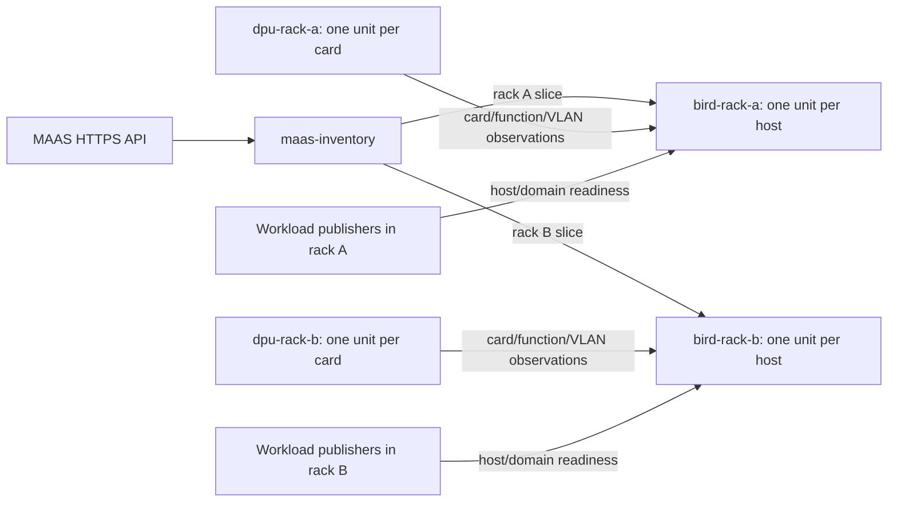

# MAAS BIRD

Rack-scoped principal machine charms for unnumbered BGP/BFD and separate Ceph
public and replication routing domains. This checkout is under validation; it is
not a production certification or a hardware-offload guarantee.

Deploy one `maas-inventory` application, one `bird` application per rack with one
unit per host, and one `dpu-attachments` application per rack with one unit per
card. None is subordinate. A generic NIC deployment can provide the same typed
attachment relation without using the DPU implementation.



The host provisioning layer owns persistent interfaces, VIPs, source rules and
unreachable guards. BIRD checks these, manages its own daemon and dynamic routes,
and never repairs, adopts or deletes those static objects. It starts disabled.
The DPU charm observes devlink, OVS VLAN membership and directly connected LLDP;
it does not configure a switch, VF or offload rule.

See [design and relation contracts](docs/design.md), the
[operations and migration runbook](docs/operations.md), and
[verification boundaries](docs/verification.md). The
[two-rack bundle](examples/rack-scoped/bundle.yaml) is illustrative and disabled;
replace placements, identities, allocations and secret IDs before use. Workload
publishers and host provisioning must be integrated separately; this repository
does not contain a Ceph charm adapter.

## Development

```bash
uv sync --locked --python 3.12
uv check
make lint
make test
BIRD_BINARY=/path/to/bird LD_LIBRARY_PATH=/path/to/libs make native
BIRD_BINARY=/path/to/bird LD_LIBRARY_PATH=/path/to/libs make namespaces
```

Native tests require BIRD 2.14. Namespace tests create disposable namespaces and
require the privileges checked by `scripts/test_namespaces.py`. Systemd tests run
inside an owned disposable local LXD guest:

```bash
uv run --locked pytest tests/systemd -q
uv run --locked pytest tests/integration --juju-controller <isolated-controller>
```

Integration tests use pytest-jubilant temporary models. The HTTPS MAAS service is
a synthetic loopback fixture inside an inventory unit. Physical DMI identities
are deliberately not forged to make synthetic inventory authorize LXD guests.

## Experimental monorepo packaging

Each charm uses Charmcraft's native `uv` plugin, `source: ../..` and
`source-subdir: charms/<name>`. The shared package is built as a sibling wheel;
there is no vendored runtime or `sys.path` workaround.

```bash
uv run python scripts/pack.py --development-charmcraft --clean
uv run python scripts/verify_artifacts.py
make schemas
```

The helper enables `CHARMCRAFT_EXPERIMENTAL_MONOREPO=1` and uses a pinned supporting
Charmcraft revision without refreshing the host snap. `--clean` clears native
part state so deleted Python modules cannot survive in the artifact. Verification
compares every shipped shared module and charm entrypoint with this checkout,
and rejects development-only Hypothesis and retired prototype modules. Arm64 is
declared but requires a native builder and its own acceptance evidence.

Historical reproductions are isolated under `tests/prototype`. They are not a
supported configuration mode and must not ship in the charms.
