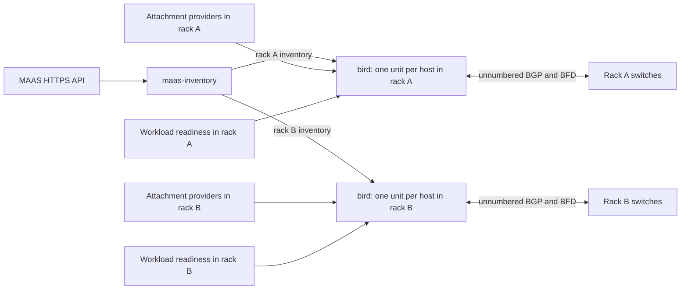

# MAAS BIRD

Manage host BGP routing in a MAAS datacenter with Juju. BIRD advertises service
addresses to your top-of-rack switches and selects an outgoing path for each
service network. BFD detects failed adjacencies so routing can use another path.

The project brings together three things: MAAS machine identity, an operator's
routing policy, and observations of the actual host-to-switch connections.
Separate routing domains can serve Ceph public, Ceph replication or other
workloads. On NUMA hosts, each source address can prefer the network attachment
on its own NUMA node while retaining a remote path for failure recovery.

**Status:** under validation, not a production release. The repository includes
three charms and their shared Python library. You must supply persistent host
networking, switch configuration and a workload-readiness integration before
routing can be enabled. Start with [deployment prerequisites](docs/getting-started.md#before-you-start).

## What runs where

| Charm | Placement | Responsibility |
|---|---|---|
| `maas-inventory` | One application for the deployment | Read MAAS over HTTPS and publish each rack's machine identities and approved switches. Keep the MAAS credential in this application. |
| `bird` | One application per rack, one unit on each participating host | Validate the host's inputs, manage its BIRD daemon, and advertise approved addresses when the workload reports them ready. |
| `dpu-attachments` | Where DPUs are used: one application per rack, one unit per card | Observe card identity, host-function mapping, VLAN membership and LLDP neighbors. Publish attachment observations to BIRD. |

All three are **principal machine charms**: place them explicitly on existing
Juju machines; they are not subordinate charms. BIRD runs on the host, not on
the DPU. The DPU charm observes forwarding configuration; it does not create it.



## Is it a fit for my datacenter?

The current target is Ubuntu 24.04, Juju 3.6 or later, and BIRD 2.14. Switches
need unnumbered eBGP over IPv6 link-local addresses, IPv4 extended next-hop,
BFD, BGP authentication and explicit route filters. See the
[switch requirements](docs/getting-started.md#switch-requirements).

The routing policy does not depend on a particular switch vendor or on Ceph.
That is an integration boundary, not a claim that every switch or NIC has been
validated. The supplied attachment provider uses DPU devlink, OVS and LLDP
observations. Ordinary NICs have a permanent-MAC identity discovery path, but
still need a compatible attachment provider; an ordinary-NIC provider is not
included. A Ceph readiness adapter is not included either.

The design keeps BIRD and attachment relations within a rack. It describes a
60-rack topology, but controller capacity and convergence at that scale still
require deployment testing. Supported boundaries and outstanding acceptance
work are listed in [verification](docs/verification.md).

## Start with one host and two switches

Read the [operator walkthrough](docs/getting-started.md). It takes you through:

1. Checking the hardware, MAAS identity and switch capabilities.
2. Assigning rack membership, host ASNs, service addresses and routing tables.
3. Preparing host networking and switch policy with their respective owners.
4. Deploying the charms disabled and integrating their inputs.
5. Reviewing the proposed routes, then enabling and testing a bounded pilot.

The walkthrough includes [readable configuration files](examples/getting-started/)
for one host with separate public and replication domains. They are examples,
not allocated production addresses. The existing
[two-rack bundle](examples/rack-scoped/bundle.yaml) shows the larger application
layout and also starts disabled.

## Who owns the network configuration?

Your host network provisioning installs interfaces, service addresses, source
routing rules and guard routes. Those guards prevent a managed source address
from falling through to the management routing table when its fabric paths fail.
BIRD verifies the static policy and manages only its own daemon and dynamic
routes. It does not repair or remove provisioning-owned objects.

Your network team configures the switches and fabric route propagation. Your
workload integration reports whether an address is ready to advertise. Neither
BGP route state nor a DPU observation alone proves hardware offload: check actual
hardware forwarding counters during normal operation and failover.

## Operator documentation

- [Getting started](docs/getting-started.md): prerequisites, example configuration
  and the path to a first pilot.
- [Dedicated VF paths](docs/dedicated-paths.md): separate Ceph VIP pairs and an
  explicitly NUMA-neutral context.
- [Operations and migration](docs/operations.md): health, updates, withdrawal and
  decommissioning.
- [Design and relation contracts](docs/design.md): ownership, schemas, source
  policy and rollback behavior.
- [Verification](docs/verification.md): what each test layer proves and the
  remaining production acceptance work.
- [RB3 offline handoff, 31 October 2026](docs/operator-handoff-20261031.md): dated
  deployment-specific configuration and evidence. Use the generic walkthrough
  for a new datacenter; do not copy RB3 allocations or secret references.

## Develop and test

```bash
uv sync --locked --python 3.12
uv check
make lint
make test
```

Native routing tests require BIRD 2.14. Set `LD_LIBRARY_PATH` only if your BIRD
build needs libraries outside the system search path:

```bash
BIRD_BINARY=/path/to/bird make native
BIRD_BINARY=/path/to/bird make namespaces
uv run --locked pytest tests/systemd -q
uv run --locked pytest tests/integration --juju-controller <isolated-controller>
```

Namespace tests create disposable Linux namespaces and check privileges before
running. Systemd tests use an owned disposable LXD guest. Integration tests use
pytest-jubilant temporary Juju models and a synthetic HTTPS MAAS fixture; they
do not establish physical switch or DPU acceptance. See
[verification](docs/verification.md) before interpreting a passing result.

## Build the charms

The experimental Charmcraft monorepo feature builds all three charms against
the shared package without copying it into each charm:

```bash
make schemas
uv run python scripts/pack.py --development-charmcraft --clean
uv run python scripts/verify_artifacts.py
```

The helper enables `CHARMCRAFT_EXPERIMENTAL_MONOREPO=1` and uses a pinned
supporting Charmcraft revision without refreshing the host snap. Each charm uses
the native `uv` plugin, `source: ../..` and `source-subdir: charms/<name>`.
`--clean` clears native part state; artifact verification checks shipped source,
metadata and native extension architecture. ARM builds require an ARM build
environment and separate runtime acceptance. See [verification](docs/verification.md) for the
current ARM evidence.

Historical reproductions under `tests/prototype` are excluded from artifacts
and are not a supported deployment mode.
