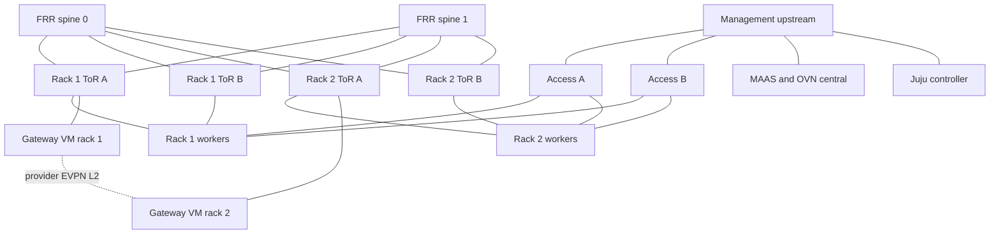

# Lab topology

The deployment uses project `maas-bird-network-lab-tf` and the
[seventeen-unit Terraform/Juju pipeline](../terraform/live/lab/README.md).
MAAS commissions the worker and controller machines. Juju's MAAS provider
places workers by exact MAAS system ID and deploys the inventory publisher,
BIRD applications and NIC observers.

Each worker has two independent fast parents with five VLAN children per
parent: access, replication and general-purpose roles. Fast parents and
general children are not bonded or assigned to OVS. Host OVS owns
workload/Geneve ports; Linux routes the stable VTEP /32 over the
general-purpose children.

ToR-to-spine links are routed. IPv6 link-local BGP carries IPv4 NLRI, with
prefix filters limiting permitted /32s. General routing uses the default
fabric context; access and replication use separate VRFs on core VLANs 3420
and 3430. Storage and host point-to-point L2 are not stretched across racks.

Provider VLAN/VNI 3405 and route target `65000:3405` form a separate EVPN L2
service. Only gateway VMs connect to provider-facing OVS bridges. Each gateway
has one fast parent carrying a routed general child and a provider child.
These VMs model separate gateways; they do not emulate dual-attached DPUs or
EVPN multihoming. OVN central runs its daemons in the MAAS VM, with local
northbound access and mutually authenticated southbound TLS/RBAC. Compute
chassis use /32 tunnel sources; the router connects tenant/provider logical
switches through prioritized gateway chassis.

LXD manages fifteen OVS carriers: management upstream, two management
downstream carriers, four rack/PF carriers and eight ToR-to-spine links.
Access containers bridge upstream to `${prefix}-ma` and `${prefix}-mb` without
IP addresses. The four workers attach their management members to different
downstream carriers; controllers remain on the upstream. Carrier names must
not overlap another carrier's reserved `name-` prefix.

Core links and their host endpoints use MTU 1600. Fast and management links
use 1500; the OVN tenant MTU is 1400. These MTUs allow for the configured
encapsulation. Extra nesting or Geneve options need a separate MTU check.

| Role | Allocated CPUs | RAM |
| --- | ---: | ---: |
| MAAS / OVN central VM | 1 | 8 GiB |
| Juju controller VM | 1 | 4 GiB |
| Six FRR containers | 6 total | 4.5 GiB total |
| Two management access containers | 2 total | 1.5 GiB total |
| Four worker VMs | 4 total | 16 GiB total |
| Two gateway VMs | 2 total | 4 GiB total |
| Total | 16 | 38 GiB |

Project caps are 16 CPUs and 56 GiB. Allocated CPUs and memory differ from
measured host CPU use and resident memory. All nodes share the hypervisor and
host switching service; see [failure domains](failure-domains.md) and
[limitations](../docs/limitations.md).
